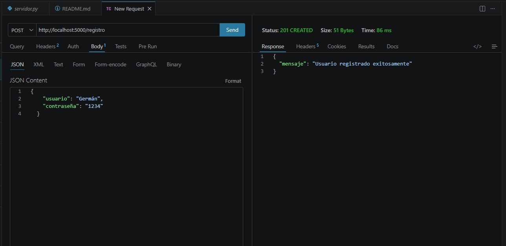
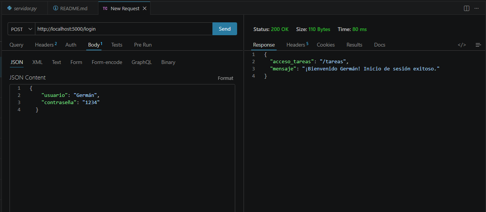

# PFO 2: Sistema de Gestión de Tareas con API y Base de Datos

Bueno, este es un servidor API básico y fácil de entender desarrollado en **Python** con **Flask** y **SQLite**. Implementa un registro de usuarios con contraseñas seguras (hasheadas), inicio de sesión y una vista de bienvenida.

---

## Requisitos Previos

Tener instalado **Python** en el sistema.

### Instalación de dependencias

Abrí una terminal en la carpeta del proyecto y ejecutá el siguiente comando para instalar Flask:

```bash
pip install Flask
```

*(Nota: SQLite y Werkzeug se incluyen automáticamente al instalar Python/Flask).*

---

## Ejecutar el servidor

Para iniciar la API, ejecutá en la terminal:

```bash
python servidor.py
```

Vas a ver una salida que contiene este texto:
```text
 * Running on http://127.0.0.1:5000
```
Esto significa que el servidor está corriendo en la dirección `http://localhost:5000`.

---

## Instrucciones para probar la API

Podes probar los endpoints usando herramientas como **Postman**, **Thunder Client**. En las imágenes muestro como sale en Thunder Client

### 1. Registro de Usuario (`POST /registro`)

Envia una petición HTTP `POST` a `http://localhost:5000/registro` con el cuerpo en formato JSON:

- **URL:** `http://localhost:5000/registro`
- **Método:** `POST`
- **Headers:** `Content-Type: application/json`  *(en Thunder Client se agrega solo)*
- **Cuerpo (JSON):**
  ```json
  {
    "usuario": "Germán",
    "contraseña": "1234"
  }
  ```

#### Respuesta esperada (201 Created):
```json
{
  "mensaje": "Usuario registrado exitosamente"
}
```

---

### 2. Inicio de Sesión (`POST /login`)

Envia una petición HTTP `POST` a `http://localhost:5000/login` comprobando el usuario y contraseña:

- **URL:** `http://localhost:5000/login`
- **Método:** `POST`
- **Headers:** `Content-Type: application/json`
- **Cuerpo (JSON):**
  ```json
  {
    "usuario": "Germán",
    "contraseña": "1234"
  }
  ```

#### Respuesta esperada (200 OK):
```json
{
  "acceso_tareas": "/tareas",
  "mensaje": "¡Bienvenido Germán! Inicio de sesión exitoso.",
}
```


---

### 3. Gestión de Tareas (`GET /tareas`)

Muestra una página HTML de bienvenida.

- **URL:** `http://localhost:5000/tareas`
- **Método:** `GET`

#### Cómo probarlo:
Abrí cualquier navegador e ingresá la URL:
```text
http://localhost:5000/tareas
```

Vas a ver una pantalla con el mensaje de bienvenida.

---

## Seguridad

- **Contraseñas Hasheadas:** En lugar de guardar `"1234"` en la base de datos en texto plano, usamos `generate_password_hash` de la librería `werkzeug.security`.
- **Verificación Segura:** Al hacer login, usamos `check_password_hash` para comparar la clave ingresada con el hash almacenado sin descifrarlo.
- **Base de Datos SQLite:** Los datos se guardan en el archivo `database.db` que se crea automáticamente al iniciar el servidor.


## Respuestas

-Hashear una contraseña no es encriptarla sino pasarla por un algoritmo matematico el cual no se puede descifrar para obtener la contraseña original. En el caso de que se vulnere la base de datos el atacante solo tendria hashes con lo que no puede hacer nada, es mas, ni el admin puede saber la contraseña una vez pasado por el algoritmo.

-SQLite es un gestor de bases de datos relacionales que se encuentra en Python. A diferencia de MySQL o PostgreSQL, no requiere un servidor separado para funcionar, lo que lo hace ideal para este proyecto u otras aplicaciones pequeñas y medianas. Solo se necesita un archivo y el motor de base de datos esta incluido en Python. No se requiere instalacion adicional.